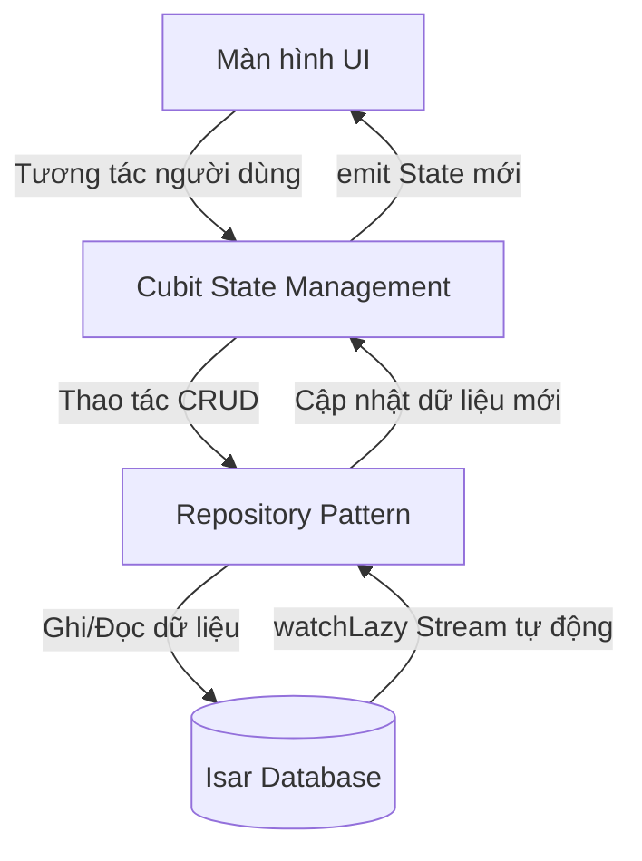

# MONEJOUR_SETUP — Hướng dẫn Thiết lập và Chạy Dự án

**Cập nhật lần cuối:** 2026-08-17

---

## 1. Tổng quan Kiến trúc
Ứng dụng **MoneJour (Giản Ký)** được phát triển bằng Flutter, hoạt động theo cơ chế **Offline-first** (lưu trữ local, hoạt động không cần mạng) và hỗ trợ đồng bộ đám mây tùy chọn qua Google Drive.

Kiến trúc mã nguồn được phân lớp rõ ràng (Separation of Concerns):
- **UI Layer (`lib/ui/`)**: Giao diện người dùng chia thành các màn hình (screens) và widget dùng chung (widgets). Hỗ trợ Material 3 (Light/Dark theme).
- **Logic Layer (`lib/logic/`)**: Quản lý trạng thái bằng Cubit (thuộc thư viện `flutter_bloc`), phản hồi sự kiện từ UI và tương tác với Repository.
- **Data/Repository Layer (`lib/data/`)**: Gồm các Model định nghĩa bảng cơ sở dữ liệu Isar (`@collection`) và Repository thực hiện CRUD, theo dõi thay đổi dữ liệu thời gian thực thông qua `Isar Watcher`.
- **Service Layer (`lib/services/`)**: Các dịch vụ bổ trợ độc lập như cơ sở dữ liệu (`database_service`), xuất nhập dữ liệu (`export_service`/`import_service`) và đồng bộ Google Drive (`cloud_sync_service`).

Sơ đồ luồng dữ liệu cơ bản:


---

## 2. Yêu cầu Hệ thống (Prerequisites)
Trước khi bắt đầu cài đặt, hãy đảm bảo máy tính của bạn đã được cài đặt các công cụ sau:

- **Flutter SDK**: Phiên bản `>=3.19.0` (khuyên dùng kênh `stable` mới nhất).
- **Dart SDK**: Phiên bản `>=3.3.0 <4.0.0` (đi kèm sẵn trong Flutter SDK tương ứng).
- **IDE**: Android Studio hoặc Visual Studio Code (đã cài đặt extension `Flutter` và `Dart`).
- **Môi trường giả lập / Thiết bị thật**:
  - **Android**: Android SDK và giả lập Android Emulator (hoặc điện thoại Android bật gỡ lỗi USB).
  - **iOS (chỉ trên macOS)**: Xcode phiên bản mới nhất, simulator iOS và CocoaPods.
  - **Windows (chạy bản Desktop)**: Visual Studio với gói công cụ **"Desktop development with C++"** (C++ desktop workload).

---

## 3. Các Bước Cài Đặt

Mở terminal và thực hiện lần lượt các bước sau:

```bash
# Bước 1: Clone dự án từ repository
git clone <repo_url>
cd project-app

# ✅ Kết quả mong đợi: Thư mục dự án đã được tải về thành công và terminal chuyển vào thư mục gốc dự án.

# Bước 2: Cài đặt các thư viện (dependencies)
flutter pub get

# ✅ Kết quả mong đợi: Hệ thống tải về đầy đủ các thư viện trong pubspec.yaml mà không báo lỗi.

# Bước 3: Tạo mã tự động cho Isar Database (Code Generation)
# Do Isar sử dụng build_runner để sinh mã cho các Model (expense, budget, journal...),
# bước này là BẮT BUỘC để tránh lỗi thiếu file *.g.dart.
dart run build_runner build --delete-conflicting-outputs

# ✅ Kết quả mong đợi: Build hoàn tất, sinh ra các file *.g.dart bên cạnh các model trong `lib/data/models/`.
```

---

## 4. Cấu hình chi tiết
### 4.1. Cấu hình Cloud Sync (Google Drive Backup/Restore)
Chức năng đồng bộ đám mây sử dụng **Google Sign-In** và **Google Drive API** (lưu trong thư mục ẩn `appDataFolder` của người dùng).
- Trong môi trường phát triển (development), bạn có thể chạy app bình thường mà không cần cấu hình Cloud Sync (chỉ không sử dụng được tính năng Backup/Restore).
- Để bật tính năng này:
  1. Tạo dự án trên [Firebase Console](https://console.firebase.google.com/).
  2. Đăng ký ứng dụng Android/iOS của bạn với Package Name / Bundle ID tương ứng (`com.example.mone_jour` hoặc cấu hình riêng).
  3. Thêm mã băm **SHA-1** của máy bạn (Debug keystore) vào cài đặt Firebase Android.
  4. Tải file cấu hình:
     - Android: Đặt `google-services.json` vào thư mục `android/app/`.
     - iOS: Đặt `GoogleService-Info.plist` vào thư mục `ios/Runner/`.
  5. Bật thư viện Google Drive API trên [Google Cloud Console](https://console.cloud.google.com/) liên kết với dự án Firebase đó.

---

## 5. Chạy Dự án (Development)
Khởi động thiết bị giả lập hoặc kết nối thiết bị thật, sau đó chạy lệnh:

```bash
# Liệt kê danh sách thiết bị đang khả dụng
flutter devices

# Chạy ứng dụng trên thiết bị mặc định
flutter run

# Chạy ứng dụng ở chế độ debug trên thiết bị cụ thể (ví dụ thiết bị id: emulator-5554)
flutter run -d emulator-5554
```
- **Kết quả mong đợi**: Ứng dụng khởi động thành công, màn hình Splash (hình Cat Paw Loading) hiển thị và chuyển tiếp vào màn hình hướng dẫn/thiết lập mã PIN. Không xuất hiện log lỗi màu đỏ trong terminal.

---

## 6. Chạy Test (Kiểm thử)
Dự án đã được thiết lập sẵn khung kiểm thử (Test framework). Các bài kiểm thử chi tiết sẽ được bổ sung trong tương lai. Bạn có thể chạy thử để kiểm tra tính toàn vẹn:

```bash
# Chạy toàn bộ các test case trong thư mục test/
flutter test
```

---

## 7. Kịch bản Kiểm thử Thủ công (Manual Test Scenarios)

Dành cho kiểm thử viên hoặc lập trình viên kiểm tra nhanh các tính năng cốt lõi sau khi khởi chạy:

| # | Bước thực hiện | Kết quả mong đợi | Trường hợp lỗi cần thử |
|---|---|---|---|
| 1 | Mở app lần đầu tiên trên máy. Thiết lập mã PIN (4 số) và câu hỏi bảo mật. | App lưu mã PIN thành công, hiển thị màn hình chính (Dashboard). | Nhập PIN xác nhận không trùng khớp → hiển thị thông báo lỗi. |
| 2 | Nhấn nút thêm giao dịch mới. Chọn danh mục "Ăn uống", nhập số tiền `50000`, nhập ghi chú "Ăn trưa". Nhấn Lưu. | Giao dịch được thêm vào danh sách, Số dư (Balance) trên màn hình chính giảm đi `50.000 ₫`. | Nhập số tiền bằng 0 hoặc bỏ trống số tiền → nút Lưu bị vô hiệu hóa hoặc báo lỗi. |
| 3 | Vào mục Hạn mức (Budget), thiết lập hạn mức tháng cho "Ăn uống" là `30000` (nhỏ hơn số tiền đã chi ở bước 2). | Hệ thống hiển thị cảnh báo đỏ hoặc tiến trình đạt `166%` vượt quá hạn mức. | Thiết lập hạn mức là số âm → không cho phép nhập hoặc báo lỗi nhập liệu. |
| 4 | Vào Cài đặt → Xuất dữ liệu → Chọn định dạng ZIP (JSON/CSV). | File ZIP được tạo ra và mở hộp thoại chia sẻ hệ thống (Share sheet) để lưu file. | Kiểm tra file ZIP xem có đủ các file CSV/JSON hợp lệ hay không. |

---

## 8. Build và Đóng gói (Production)

Khi dự án đã sẵn sàng phát hành, hãy chạy các lệnh build tương ứng:

### Android
```bash
# Build file APK cài đặt trực tiếp
flutter build apk --release

# Build file App Bundle để upload lên Google Play Store
flutter build appbundle --release

# ✅ Kết quả mong đợi: File output được tạo tại build/app/outputs/flutter-apk/app-release.apk
```

### iOS (Chỉ chạy trên macOS)
```bash
# Build thư mục ứng dụng và archive
flutter build ipa --release

# ✅ Kết quả mong đợi: Xcode build thành công và xuất file archive phục vụ upload App Store Connect.
```

---

## 9. Xử lý Sự cố Thường gặp

| Vấn đề | Nguyên nhân | Cách khắc phục |
|---|---|---|
| Lỗi thiếu file `*.g.dart` hoặc các class Isar không tìm thấy khi code | Chưa chạy code generator để sinh code cho cơ sở dữ liệu Isar. | Chạy lệnh: `dart run build_runner build --delete-conflicting-outputs` |
| Lỗi tải thư viện C++ Isar (`isar.dll` hoặc `libisar.so`...) trên thiết bị | Cache của Flutter pubspec bị lỗi hoặc không khớp phiên bản CPU. | Chạy `flutter clean` sau đó chạy lại `flutter pub get` để tải lại thư viện. |
| Lỗi `CocoaPods' specifications repo is out of date` khi build iOS | CocoaPods trên máy Mac chưa cập nhật spec repo mới nhất của các thư viện. | Chạy lệnh: `cd ios && pod install --repo-update` |
| Không thể đăng nhập Google để đồng bộ đám mây | Cấu hình mã SHA-1 debug keystore chưa khớp với Firebase/Google Console. | Kiểm tra và thêm đúng mã băm SHA-1 (Debug và Release) vào Firebase Console. |
